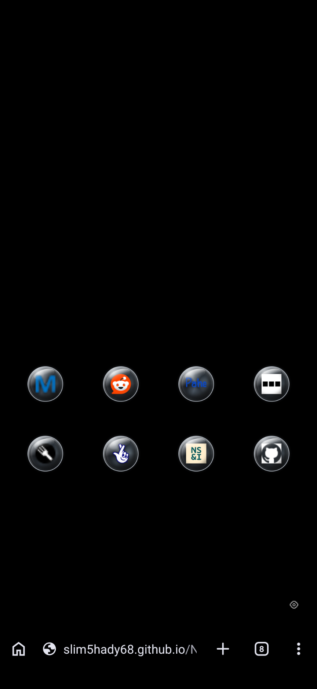
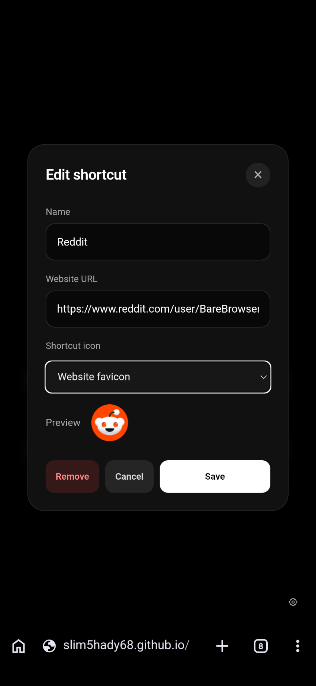

# NTPure — Minimalist Customisable New Tab Page

**Version 2.2 (test)** · **Authored by JT26-AI**

NTPure is a lightweight, customisable New Tab Page with an optional true-black AMOLED background or your own wallpaper. Keep your favourite websites within reach, arrange shortcuts your way, and enjoy a clean interface without a built-in search bar or unnecessary clutter.

**Try NTPure (after publishing):** https://slim5hady68.github.io/NTPure/

## Screenshots

  
  
  

Smoked Glass icons · Appearance settings · Shortcut editor (tap an image for full size)

## Features

- **Three icon styles:** Floating (borderless), Uniform Rounded Tiles, and Smoked Glass with glossy reflections and dimensional shading.
- **Customisable shortcut icons:** Personalise each shortcut icon individually using its website favicon or your own PNG/JPG/WebP image.
- **Flexible shortcut grid:** Choose 4, 5 or 6 columns, small/medium/large icons, and optional website labels.
- **Drag-and-drop ordering:** Press and hold a shortcut to rearrange it.
- **Optional clock and date:** Show or hide them in Settings.
- **Discreet settings panel:** A 12px grey cog opens a slide-up panel; close it using × or by tapping outside.
- **Backup and restore:** Export shortcuts, icon choices, uploaded icon images, wallpapers, and preferences to a JSON file.
- **Custom wallpaper:** Upload a background image and adjust its darkness with a slider; AMOLED black remains the default.
- **Local storage and caching:** Your setup stays in your browser, while service-worker caching can improve repeat load times.

## Moving from NTP-Am to NTPure

**Important:** Renaming the GitHub repository changes the GitHub Pages URL. Browser storage does **not** automatically move between `/NTP-Am/` and `/NTPure/`. Before switching, open the old NTP-Am page and use **Settings → Export backup**. After uploading NTPure and opening the new URL, use **Settings → Restore backup**. NTPure accepts backups created by NTP-Am as well as NTPure. Update your BareBrowser Custom New Tab URL to the new address only after restoring and verifying your shortcuts and wallpaper.

## Getting Started

Open **https://slim5hady68.github.io/NTPure/**.

### Use with BareBrowser on Android

1. Install or enable the **Custom New Tab URL** extension.
2. Set its URL to `https://slim5hady68.github.io/NTPure/`.
3. Save and open a new tab.

Other browsers may offer different ways to configure a custom New Tab Page.

## How to Use

### Add, edit, or remove shortcuts

- **Add:** Tap an empty **+** position, enter a website name and URL, then save.
- **Edit:** Open Settings → **Edit shortcuts**, then tap the shortcut you want to change. Tap **Done** to return to normal browsing.
- **Remove:** Open the shortcut editor and choose **Remove**.
- **Rearrange:** Press and hold a shortcut, move it to another position, then release.

### Choose a custom icon

In the shortcut editor, select an icon source:

1. **Website favicon** — use the website's automatically retrieved icon.
2. **Upload image** — choose a PNG, JPG, or WebP file from your device. NTPure resizes uploaded icons to 96 × 96 pixels and stores them locally.

You can switch back to the website favicon at any time. Uploaded icons are stored locally and can be included in your backups.

### Change the appearance

Tap the small grey cog in the bottom-right corner. Under **Icon style**, choose:

| Style | Appearance |
| --- | --- |
| **Floating** | Clean, borderless icons over any background |
| **Uniform Rounded Tiles** | Consistent rounded-square icon backgrounds |
| **Smoked Glass** | Glossy, smoky circular icons with highlights and depth |

You can also change the number of grid columns, icon size, label visibility, and clock/date display. Your choices are saved automatically.

### Back up and restore

Open Settings and choose **Export backup** to download a JSON file. Use **Restore backup** to import a saved configuration.

Backups include your shortcut order, preferences, uploaded icon images, and wallpaper image data. **Restoring a backup replaces the current configuration**, so export your existing setup first if you want to keep it.

## Privacy and Storage

NTPure stores shortcuts, uploaded icons, and preferences locally in your browser using `localStorage`. Your personal shortcut configuration is not uploaded to GitHub.

Website favicons may be fetched from Google's favicon service.

Clearing browser site data can remove your saved shortcuts and settings. Keep a JSON backup, especially before changing browsers or clearing data.

## Custom Wallpapers

Open **Settings → Background** and tap **Upload wallpaper** to choose a PNG, JPG or WebP image from your device. NTPure resizes and compresses it locally. Use the **Wallpaper darkness** slider (0–90%) to change the appearance immediately, or select **AMOLED black** to remove the wallpaper.

Uploaded wallpapers are stored in your browser and included in exported JSON backups. Keep a backup before clearing browser data.

## What's New in v2.2 (performance test)

- Upload a custom wallpaper and adjust its darkness using a live slider.
- Keep pure AMOLED black as the default.
- Simplified shortcut icons to website favicons or image uploads.
- Include uploaded wallpaper images and darkness preferences in backups.

## Credits

**NTPure v2.2 (performance test)**  
**Authored by JT26-AI**  
**Icon concept credit: DrumDestroyer**

*Minimalist by design. Personalised by you.*

## v2.2 Performance Test Notes

This is an experimental build based on the stable v2.1 release. It retains the original JavaScript shortcut navigation and touch/drag code. Changes include synchronous favicon URL assignment, avoiding redundant shortcut grid rebuilding on unchanged preferences, separate wallpaper darkness overlay, writing wallpaper data only after a slider adjustment finishes, and optional local console timing with `?perf=1`. These changes have not been benchmarked in BareBrowser; retain a backup and compare with v2.1 before replacing the stable release.

## Preview Test 12
Adds a photo preview directly in Settings to distinguish saved-image decoding from wallpaper compositing. Does not alter saved settings.
