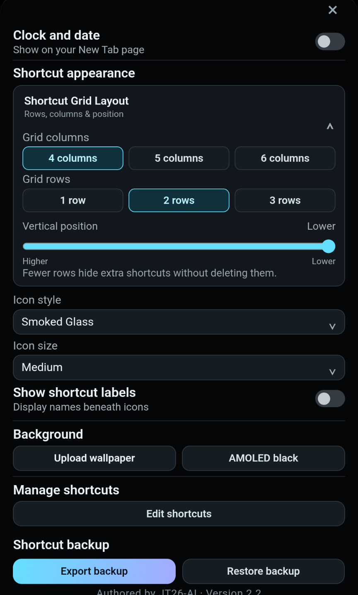

# NTP-Am — Minimalist AMOLED New Tab Page

**Version 2.0.3** · **Authored by JT26-AI**

NTP-Am is a lightweight, customisable New Tab Page with a true-black AMOLED background. Keep your favourite websites within reach, arrange shortcuts your way, and enjoy a clean interface without a built-in search bar or unnecessary clutter.

**Try NTP-Am:** https://slim5hady68.github.io/NTP-Am/

## Screenshots

  
  
  

Smoked Glass icons · Appearance settings · Shortcut editor (tap an image for full size)

## Features

- **Three icon styles:** Floating (borderless), Uniform Rounded Tiles, and Smoked Glass with glossy reflections and dimensional shading.
- **Customisable shortcut icons:** Personalise each shortcut icon individually using its website favicon, your own PNG/JPG/WebP image, or a direct HTTPS image URL.
- **Flexible shortcut grid:** Choose 4, 5 or 6 columns, small/medium/large icons, and optional website labels.
- **Drag-and-drop ordering:** Press and hold a shortcut to rearrange it.
- **Optional clock and date:** Show or hide them in Settings.
- **Discreet settings panel:** A 12px grey cog opens a slide-up panel; close it using × or by tapping outside.
- **Backup and restore:** Export shortcuts, icon choices, uploaded icon images, and preferences to a JSON file.
- **Local storage and caching:** Your setup stays in your browser, while service-worker caching can improve repeat load times.

## Getting Started

Open **https://slim5hady68.github.io/NTP-Am/**.

### Use with BareBrowser on Android

1. Install or enable the **Custom New Tab URL** extension.
2. Set its URL to `https://slim5hady68.github.io/NTP-Am/`.
3. Save and open a new tab.

Other browsers may offer different ways to configure a custom New Tab Page.

## How to Use

### Add, edit, or remove shortcuts

- **Add:** Tap an empty **+** position, enter a website name and URL, then save.
- **Edit:** Double-tap an existing shortcut to open its editor.
- **Remove:** Open the shortcut editor and choose **Remove**.
- **Rearrange:** Press and hold a shortcut, move it to another position, then release.

### Choose a custom icon

In the shortcut editor, select an icon source:

1. **Website favicon** — use the website's automatically retrieved icon.
2. **Upload image** — choose a PNG, JPG, or WebP file from your device. NTP-Am resizes uploaded icons to 96 × 96 pixels and stores them locally.
3. **Image URL** — paste a direct HTTPS link to an image.

You can switch back to the website favicon at any time. Image URLs depend on the remote image remaining available; uploaded images are stored locally.

### Change the appearance

Tap the small grey cog in the bottom-right corner. Under **Icon style**, choose:

| Style | Appearance |
| --- | --- |
| **Floating** | Clean, borderless icons on pure black |
| **Uniform Rounded Tiles** | Consistent rounded-square icon backgrounds |
| **Smoked Glass** | Glossy, smoky circular icons with highlights and depth |

You can also change the number of grid columns, icon size, label visibility, and clock/date display. Your choices are saved automatically.

### Back up and restore

Open Settings and choose **Export backup** to download a JSON file. Use **Restore backup** to import a saved configuration.

Backups include your shortcut order, preferences, custom icon URLs, and uploaded icon image data. **Restoring a backup replaces the current configuration**, so export your existing setup first if you want to keep it.

## Privacy and Storage

NTP-Am stores shortcuts, uploaded icons, and preferences locally in your browser using `localStorage`. Your personal shortcut configuration is not uploaded to GitHub.

Website favicons may be fetched from Google's favicon service. If you choose an external image URL, your browser requests that image from its host.

Clearing browser site data can remove your saved shortcuts and settings. Keep a JSON backup, especially before changing browsers or clearing data.

## Performance and Offline Use

A service worker caches page resources and supported favicons to improve repeat visits. The page may load offline after an initial successful visit, depending on browser support and which resources have been cached. Remote custom image URLs may still require a connection.

## What's New in v2.0.3

- Enhanced **Smoked Glass** icons with stronger highlights, a polished rim, and deeper shadows.
- Added custom shortcut icons via **image upload** or **direct HTTPS image URL**.
- Included uploaded custom icons and icon preferences in JSON backups.

## Credits

**NTP-Am v2.0.3**  
**Authored by JT26-AI**  
**Icon concept credit: DrumDestroyer**

*Minimalist by design. Personalised by you.*
